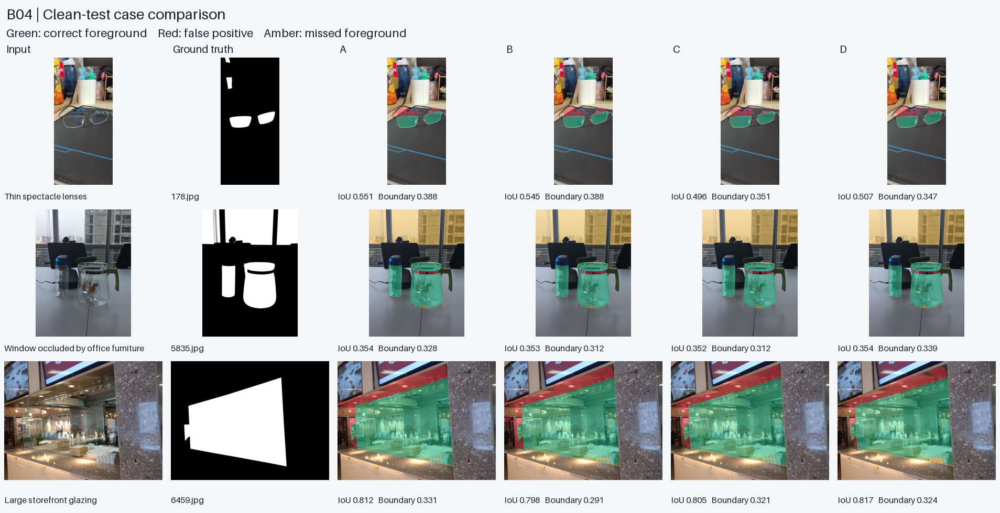

# B03 / B04 主消融与边界分析

B 和 D 共享验证网格在 PR #4 选出的 `r=2, λ=0.1`。两组使用与 A/C 相同的共享初始化、数据和训练预算，各训练 30 轮、18,600 步。B 开启边界辅助监督，D 同时开启边界监督和光度增强。

四组以验证集前景 IoU 选权重，随后在同一批 4,428 张原尺寸测试图上评估。

| 模型 | 前景 IoU | F1 | Boundary IoU | 背景 FPR |
|---|---:|---:|---:|---:|
| A | 87.436% | 93.297% | 68.087% | 2.834% |
| B | 87.530% | 93.350% | 68.238% | 2.805% |
| C | 87.500% | 93.334% | 68.059% | 2.769% |
| D | 87.465% | 93.314% | 68.021% | 2.576% |

同一增强条件下加边界头的变化（百分点，正值为增加）

| 比较 | 子集 | Δ前景 IoU | ΔF1 | ΔBoundary IoU | Δ背景 FPR |
|---|---|---:|---:|---:|---:|
| B_minus_A | all | +0.094 | +0.053 | +0.151 | -0.030 |
| D_minus_C | all | -0.035 | -0.020 | -0.038 | -0.192 |
| interaction | all | -0.129 | -0.073 | -0.189 | -0.163 |
| B_minus_A | easy | +0.078 | +0.042 | +0.109 | -0.031 |
| D_minus_C | easy | +0.017 | +0.009 | -0.060 | -0.101 |
| interaction | easy | -0.061 | -0.033 | -0.169 | -0.070 |
| B_minus_A | hard | +0.139 | +0.089 | +0.310 | -0.023 |
| D_minus_C | hard | -0.245 | -0.156 | +0.046 | -0.549 |
| interaction | hard | -0.383 | -0.245 | -0.264 | -0.526 |

交互是（D−C）减去（B−A）。它描述增强开启时，边界辅助监督的观测收益变化。
IoU/F1 按像素池化，Boundary IoU 是每张图的均值。结果来自单 seed，C 来自另一台 GPU，且 Python 版本不同。
B02 原入选模型的共享初始化哈希不同，正式主表使用在本机重新跑完的匹配初始化 B。

在未开启光度增强时，B 相对 A 的整体前景 IoU 提升 0.094 个百分点，Boundary IoU 提升 0.151 个百分点。困难图的边界增益为 0.310 个百分点，高于 easy 的 0.109 个百分点。

开启光度增强后，D 相对 C 的整体前景 IoU 下降 0.035 个百分点，Boundary IoU 下降 0.038 个百分点，同时背景误检率下降 0.192 个百分点。困难图上的 D−C 权衡更明显：Boundary IoU 增加 0.046 个百分点、背景误检率下降 0.549 个百分点，但前景 IoU 下降 0.245 个百分点。两组总体边界效应之差为 −0.189 个百分点。表中数值是本次单种子观测，训练环境差异和种子方差限制了对交互的归因。

定性样本先根据 A 的低边界得分和原图目视选择，随后固定图像成员。逐图指标见 `B04_failure_cases.csv`。

- 薄镜片 `178.jpg`：四组基本保留镜片，却把部分镜框或周围不透明物体判成前景。B 相对 A 的 Boundary IoU 仍约为 0.388。
- 家具遮挡 `5835.jpg`：四组分出桌上的透明器皿，却漏掉大面积背景窗格。D 的 Boundary IoU 为 0.339，四组整图 IoU 都约为 0.35。
- 大窗 `6459.jpg`：四组沿窗的上边缘误分了上方饰面。区域 IoU 在 0.798–0.817，Boundary IoU 仅 0.291–0.331，说明区域重叠会掩盖轮廓偏移。
